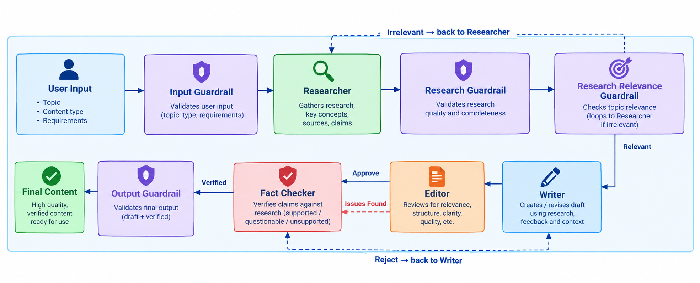

# Multi-Agent Content Pipeline

The Multi-Agent Content Pipeline is an AI-powered content generation system designed to demonstrate how multiple specialized agents can work together to complete a content creation task in a controlled and reliable manner.

A Researcher Agent first gathers and organizes information relevant to the requested topic. A Writer Agent uses the research and user requirements to generate the initial content. An Editor Agent evaluates the generated content for relevance, structure, clarity, completeness, and adherence to requirements. Finally, a Fact Checker Agent evaluates factual claims against the available research context. The agents communicate through a shared state, allowing information produced at one stage to be consumed by subsequent stages without losing the context of the original request. Instead of following a strictly linear pipeline, the system supports conditional routing and feedback loops.
 
The system also includes multiple guardrails that validate inputs, research, shared state, and final output before allowing the workflow to continue. This prevents downstream agents from operating on incomplete or invalid information. To avoid infinite execution loops, revision and retry limits are enforced, allowing the system to terminate safely when the workflow cannot reach a satisfactory result.

---

## Architecture


> **Project Architecture Diagram**
>
> Replace the image below with the architecture image of the project.

```text

```

---

# Features

## 1. Multi-Agent Architecture

The system divides the content generation process into multiple specialized agents.

Each agent has a clearly defined responsibility instead of requiring one agent to perform research, writing, editing, and verification simultaneously.

---

## 2. Specialized Agents

| Agent                  | Responsibility                                                                              |
| ---------------------- | ------------------------------------------------------------------------------------------- |
| **Researcher Agent**   | Produces relevant research and supporting information for the requested topic               |
| **Writer Agent**       | Generates the requested content using the research and user requirements                    |
| **Editor Agent**       | Reviews the generated content for quality, relevance, structure, and requirement compliance |
| **Fact Checker Agent** | Checks whether claims in the draft are supported by the available research                  |

### Researcher Agent

The Researcher is the first content-processing agent.

It receives:

* Topic
* Content type
* User requirements

It produces:

* Topic definition
* Important concepts
* Relevant information
* Important points to cover
* Potential factual claims
* Suggested sources or organizations

Its purpose is to create the information that later agents can use.

---

### Writer Agent

The Writer receives the research and creates the requested content.

For the initial generation, it receives:

```text
Topic
Content Type
Requirements
Research
Sources
```

When the workflow enters a revision loop, the Writer additionally receives:

```text
Previous Draft
Editor Feedback
Fact-Checking Results
```

This allows the Writer to improve an existing draft instead of treating every execution as a completely new request.

---

### Editor Agent

The Editor acts as a quality-control stage.

It evaluates:

* Topic relevance
* Requirement compliance
* Structure
* Clarity
* Missing information
* Unsupported or questionable claims
* Repetition
* Unnecessary content
* Overall quality

---

### Fact Checker Agent

The Fact Checker evaluates factual claims present in the generated draft.

The current implementation compares claims against the research context available in the shared state.

---

# Guardrails

Guardrails are validation points placed between important stages of the workflow.

Their purpose is simple:

> **Do not allow the workflow to continue when the information required by the next stage is missing, invalid, or unsuitable.**

---

## Input Guardrail

The Input Guardrail validates the initial user request.

It checks whether:

* A topic was provided
* The topic is meaningful
* A content type was provided
* Requirements were provided
* Requirements contain enough information

---

## Research Guardrail

After the Researcher finishes, the Research Guardrail checks whether usable research was produced.

It verifies:

* Research exists
* Research is not empty
* Research contains sufficient information
* Source information exists

Without this guardrail, the Writer could receive an empty or unusable research result.

---

## Research Relevance Guardrail

A research response can technically exist while still being about the wrong subject.

For example, a topic can have multiple possible meanings.

The Research Relevance Guardrail checks:

> "Is this research actually about the topic requested by the user?"

If the research is irrelevant, the workflow can return to the Researcher.

---

## Output Guardrail

The final output is also validated.

The Output Guardrail checks that:

```text
Final Draft exists & Fact Checking has passed
```

Only then is the workflow marked as successfully completed.

---

# Shared State and Context

The agents do not communicate by directly calling each other.

Instead, they communicate through a **shared state**.

Think of the shared state as a common workspace containing everything the workflow has learned so far.

---

# Project Structure

```text
multi-agent-content-pipeline/
│
├── app/
│   │
│   ├── agents/
│   │   ├── researcher.py
│   │   ├── writer.py
│   │   ├── editor.py
│   │   └── fact_checker.py
│   │
│   ├── graph/
│   │   ├── workflow.py
│   │   ├── nodes.py
│   │   └── routing.py
│   │
│   ├── state/
│   │   └── content_state.py
│   │
│   ├── guardrails/
│   │   ├── input_guardrail.py
│   │   ├── research_guardrail.py
│   │   ├── research_relevance_guardrail.py
│   │   ├── state_guardrail.py
│   │   └── output_guardrail.py
│   │
│   ├── llm/
│   │   └── local_qwen.py
│   │
│   ├── evaluation/
│       └── metrics.py
│
├── .gitignore
├── requirements.txt
├── README.md
└── run.py
```

---


# Installation

## 1. Clone the Repository

```powershell
git clone <YOUR_GITHUB_REPOSITORY_URL>
cd multi-agent-content-pipeline
```

---

## 2. Create Virtual Environment

```powershell
python -m venv .venv
```

Activate it:

```powershell
.\.venv\Scripts\Activate.ps1
```

---

## 3. Upgrade pip

```powershell
python -m pip install --upgrade pip
```

---

## 4. Install Dependencies

```powershell
pip install -r requirements.txt
```

---

## 5. Verify PyTorch and GPU

```powershell
python -c "import torch; print(torch.cuda.is_available()); print(torch.cuda.get_device_name(0) if torch.cuda.is_available() else 'CPU')"
```

---

## 6. Run the Application

```powershell
python run.py
```

---

# Feature Improvements

Possible future improvements include:

* Real web search integration for research
* Larger local or hosted LLM
* Human approval nodes
* Source credibility scoring
* Automated quality scoring
* API layer for submitting content requests
* Web UI for monitoring workflow execution


